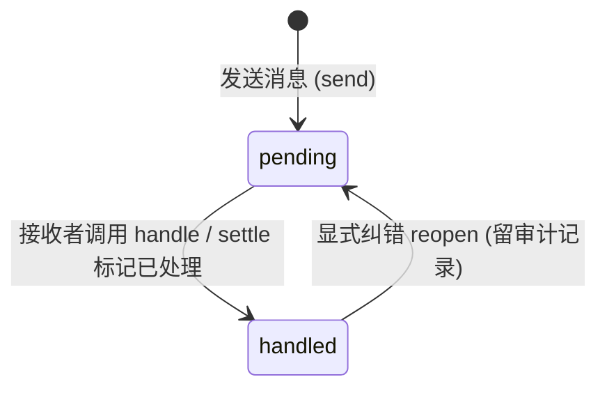

# 产品一：AgentTeam 轻量级角色沟通软件设计文档

> **文档状态**：定稿设计（v1.1，已确认 MCP 主入口 + 薄 CLI 兜底、随 `$at-init-team` 初始化目录）\
> **实施修订（2026-11-27）**：每次外发必带幂等键，送验与打回使用实际流转事件。跨群结算以持锁写入短期事务记录为提交点，读者叠加已提交的数据，后续写入完成恢复。收件按 P0–P3 分页，返回 next_cursor；未完成事项保留 pending。角色目录用于可信本机的身份核对。完整调用字段见[通讯协议](../../skills/at-receive-message/references/protocol.md)。
>
> **配套文档**：\
> - [产品二：新 Skill 设计与老 Skill 配套改动方案](02-skills-and-workflow-design.md)\
> - [产品三：通讯内容可视化 HTML 项目设计文档](03-chat-visualizer-html-design.md)

---

## 1. 产品定位与设计原则

### 1.1 背景与核心定位
AgentTeam 当前已具备角色建档（`$at-add-team-member`）、多角色会议（`$at-team-discuss`）、需求流转（`$at-add-worklist` / `$at-manage-workspace`）、开工交付（`$at-work`）与验收（`$at-review-work`），但各角色之间缺少**轻量、异步、可追溯的点对点/群组提醒渠道**。

本软件定位为 **项目内异步待办提醒与协作通告工具**，不是通用即时通讯（IM）或闲聊软件。核心目标是解决以下痛点：
- **送验提醒**：角色 A 完成需求并放入 `3待验收` 后，通知指定验收人 B 及时验收。
- **打回与审阅反馈**：验收人或审阅人发现问题时，将明确原因及引用文件路径发回给执行角色。
- **协作与依赖提醒**：某角色被上游接口、素材或决策阻塞时，向相关角色发出精准提醒。

### 1.2 核心约束与设计原则

| 原则 | 具体落地方式 |
| --- | --- |
| **零联网、零好友、纯本地项目内隔离** | 不连接任何远程服务器；通讯名单直接来自项目根 `AT.json` 的 `members` 与内置身份 `"用户"`；数据存放在当前使用 AgentTeam 的项目目录内部，天然杜绝跨项目串话。 |
| **按需求建群 + 精准定向接收** | 采用聊天群组而非私聊窗口，通常每个需求对应一个群组（单个需求群组文件在首次发消息时按需创建）；每条消息必须显式指定 1 至多位接收者 `to[]`（常见为 1 位），不支持无差别的 `@all` 全员广播。 |
| **软件归技能、数据归项目** | 软件源码放在 `skills/at-receive-message/scripts/` 内随 Skill 安装运行（零额外安装包）；通讯数据目录 `public/chat/`（若与团队代码仓同名则避让为 `public/at-chat/`）随 `$at-init-team` 初始化项目时一并建立。 |
| **极简技术栈、单事实源** | 100% Python 3.11+ 标准库，无数据库引擎、无常驻进程、无第三方依赖；按群组拆分 UTF-8 JSON 文件作为唯一事实源（SSOT）。 |
| **明确状态机与防吞待办** | 每条消息针对**每一位接收者**独立维护 `pending`（未处理）/ `handled`（已处理）状态，单接收者场景与消息整体状态一一对应，多接收者场景互不覆盖。 |
| **反闲聊、精简与路径引用** | 强制业务意图分类 `kind`，禁止礼貌性空回复；正文设严格字数上限；引用代码/报告/需求一律传项目内相对路径 `refs[]`，禁止上传附件或粘贴大段原文。 |
| **可追溯发送者与 AI 模型** | 强制记录发送角色、发送 AI 模型（如 GPT / Gemini 系列）、处理时间与处理 AI 模型，便于追踪多模型协作质量。 |
| **MCP 主入口 + 薄 CLI 兜底** | 内核引擎 `chat_core` 与传输层彻底解耦：一期直接以纯 Python 标准库零依赖实现的 stdio **MCP Server（`at_chat_mcp.py`）** 作为 Agent 主入口，提供强类型 Schema 与免临时文件调用；同时保留同内核的极薄 CLI（`at_chat.py`）供无 MCP 宿主兜底与自动化测试。 |

---

## 2. 目录布局与部署形态

### 2.1 软件代码位置（放到 Skill 内部）
遵循 AgentTeam 现有“共用脚本内聚在技能目录、各技能平级相对调用”的部署方式（由仓库根目录 `install.py` 自动复制 `skills/at-*` 到 `$CODEX_HOME/skills` 或自定义目录）：

```text
skills/
├─ at-receive-message/
│  ├─ SKILL.md
│  ├─ agents/openai.yaml
│  ├─ references/
│  │  └─ protocol.md              # 通讯 CLI 参数、错误码与协议细则
│  └─ scripts/
│     ├─ at_chat_mcp.py           # 一期主入口：零依赖标准库 stdio MCP Server（由 install.py 自动注册）
│     ├─ at_chat.py               # 薄 CLI 兜底与自动化测试入口（~60 行，直接委托 chat_core.engine）
│     └─ chat_core/
│        ├─ __init__.py
│        ├─ fs.py                 # 项目定位(AT.json)、路径越界防护、原子写、跨平台文件锁
│        ├─ models.py             # 数据校验、模型家族归类、状态机规则
│        ├─ store.py              # public/chat/ 读写与群组管理（单事实源）
│        ├─ tasks_bridge.py       # 只读桥接项目 AT_*/workspace 需求元信息与实时阶段
│        └─ engine.py             # 核心业务用例（receive/send/handle/settle/groups/history/summary）
└─ at-reply-message/
   ├─ SKILL.md                    # 优先调用 agent-team-chat MCP 工具，兜底调用 ../at-receive-message/scripts/at_chat.py
   └─ agents/openai.yaml
```

> **为什么独立放在 `skills/at-receive-message/scripts/` 而不是塞进 `skills/at-init-team/scripts/at.py`？**
> 1. 严格满足“软件本身放到通讯 Skill 内部”的产品边界，模块完全内聚、可独立测试与演进。
> 2. 仍与 `at.py` 共享相同项目约定（读取 `AT.json`、遵循 `agent-team/v3` 格式校验、采用相同的 `context_role` 角色目录边界规则），但使用独立锁文件 `.at-state/chat.lock`，避免与耗时的 `git sync` / `deliver` / `verify-bin` 互抢 `agent-team.lock`。
> 3. 在安装目录中，`at-receive-message`、`at-reply-message`、`at-work`、`at-review-work` 均为平级子目录，通过 `../at-receive-message/scripts/at_chat.py` 即可稳定解析绝对路径。

### 2.2 项目内通讯数据存储位置
通讯数据保存在目标 AgentTeam 项目的 `public/` 公共协作区下，与 `public/meetings/`（会议纪要）形成对称：

```text
我的项目/
├─ AT.json                        # 既有：项目元信息与成员注册表（不破坏 agent-team/v3 结构）
├─ .at-state/
│  ├─ agent-team.lock             # 既有：需求/记忆/Git 主锁
│  └─ chat.lock                   # 新增：通讯专用跨平台内核文件锁（首次写消息时创建）
├─ public/
│  ├─ <团队仓库名>/                # 既有：团队代码 main 工作树
│  ├─ meetings/                   # 既有：会议纪要
│  └─ chat/                       # 新增：项目内通讯数据目录（若团队仓库名恰为 chat，则避让为 public/at-chat/）
│     ├─ meta.json                # 通讯库元信息（格式版本、project_id 校验、自增序号、群组索引）
│     └─ groups/
│        ├─ task__AT-9f2a...json  # 需求群组文件（每群一个 JSON 文件，文件名稳定且 Windows 安全）
│        └─ topic__v1-release.json# 专题协作群文件（非单需求跨模块协作）
├─ AT_<角色名>/                    # 既有：各角色独立 Git 仓库（不存聊天数据，避免跨角色提交冲突）
└─ publish/                       # 既有：对外发布目录
```

**关键目录设计决策**：
- **随项目初始化直接建立**：执行 `$at-init-team`（`team.py: init()`）初始化空项目时，直接同步创建 `public/chat/`（若冲突则为 `public/at-chat/`）、空 `groups/` 子目录以及初始 `meta.json`（含 `format: "agent-team/chat-v1"`、`project_id`、`next_seq: 1`、`groups: []`）。单个需求对应的群组文件（`groups/task__<task_id>.json`）仍在该需求首次收发消息时按需生成，避免建单产生大量空群文件。
- **团队仓库名冲突避让**：与 `records.py` 处理 `meetings` / `meeting-notes` 的策略一致——检测 `Path(data["team_repo"]).name.casefold() == "chat"`，若冲突则自动改用 `public/at-chat/`（`at-init-team`、通讯软件和可视化服务共用同一解析规则）。
- **独立于业务代码与角色 Git 仓**：通讯记录属于项目级本地运行协作数据，不污染 `public/<团队仓库名>` 的代码提交历史，也不写入任何单个 `AT_<角色名>/` 仓库（防止角色 A 给角色 B 发消息时越权修改 B 的仓库）。

---

## 3. 领域模型与数据 Schema（`agent-team/chat-v1`）

### 3.1 群组（Group）模型
群组分为两类：

| `kind` | 标识规范 `group_id` | 文件名 | 创建方式 | 典型用途 |
| --- | --- | --- | --- | --- |
| `task` | `task:<task_id>`（例如 `task:AT-3a7f...`） | `task__<task_id>.json` | 首次向该需求发消息时**自动惰性创建** | 单一需求的送验提醒、验收打回、开发与验收协作（90%+ 的场景）。 |
| `topic` | `topic:<slug>`（字母/数字/短横线，1–48 字符） | `topic__<slug>.json` | 调用 `create-group` 显式创建（或首次发消息带 `create_topic` 参数） | 跨需求的专题协作（如“v1.0 封版协调”、“美术资源命名规范对齐”）。 |

> **为什么需求群组绑定 `task_id`（`AT-<32hex>`）而不是需求文件路径？**\
> 需求文件在 `1新需求 → 2处理中 → 3待验收 → 4已归档` 流转时路径会变化，而正文内的 `AT-<32hex>` 是永久不变的主键。群组记录 `task_id` 后，读取时动态桥接 `AT_*/workspace/` 即可获得该需求的最新阶段、当前验收人、短编号（如 `Dev00001`）与标题，永不失效。

### 3.2 消息意图类型（`kind`）
严格限制消息必须归属于 5 种有效工作意图，从数据结构层杜绝闲聊：

| `kind` | 中文名 | 典型触发场景 | 是否期望接收者有后续行动 |
| --- | --- | --- | --- |
| `review_request` | 送验提醒 | 需求已移至 `3待验收`，提醒验收人核验交付物 | 是（执行验收并核销） |
| `review_rejected` | 验收打回 | 验收未通过并已退回 `2处理中`，告知失败项与复现依据 | 是（修复返工并核销） |
| `review_feedback` | 审阅反馈 | 审阅他人代码/设计/报告时发现问题，及时提醒改进 | 是（评估修正并核销） |
| `collab_request` | 协作提醒 | 需要对方提供接口、素材、决策或协助解除依赖阻塞 | 是（协同处理并核销） |
| `info_sync` | 关键节点同步 | 阻塞已解除、接口变更通告等影响接收者下一步工作的关键信息 | 是（知悉调整并核销，通常无需回信） |

### 3.3 接收者状态模型与聚合状态
为兼顾“通常 1 位接收者”的直观性与“允许指定多位接收者”的正确性，消息内为每位接收者维护独立处理记录：



- **单接收者状态（`recipients[role].status`）**：
  - `pending`（未处理）
  - `handled`（已处理）
- **处理结论枚举（`recipients[role].resolution`）**：
  - `accepted`：已验收通过/已采纳，无需发新消息
  - `replied`：已处理并发送了回复/打回消息（自动写入 `reply_message_id`）
  - `resolved`：已完成所要求的工作/修复/协作
  - `noted`：已知悉同步信息并调整了计划/记忆，无需回复
  - `deferred`：已评估但因外部阻塞暂挂，已在需求或新消息中说明
- **消息级汇总状态（`overall_status`，派生字段，落盘便于展示）**：
  - 全部接收者为 `pending` → `"pending"`
  - 部分 `handled`、部分 `pending` → `"partial"`（仅多接收者场景出现）
  - 全部接收者为 `handled` → `"handled"`

> 当接收者只有 1 位时，`overall_status` 永远只有 `"pending"` 或 `"handled"`，完全贴合直觉；当接收者有 2 位以上时，角色 B 标记自己已处理绝不会误吞角色 C 的待办。

### 3.4 文件 Schema 与具体示例

#### (1) `public/chat/meta.json`
```json
{
  "format": "agent-team/chat-v1",
  "project_id": "7f3a2e4c-1b9d-4c8a-9f11-8e0a1c2d3e4f",
  "next_seq": 4,
  "updated_at": "2026-11-27T11:25:10.123456+00:00",
  "groups": [
    {
      "group_id": "task:AT-9f2a1c0b8e7d6c5b4a3f2e1d0c9b8a7f",
      "file": "task__AT-9f2a1c0b8e7d6c5b4a3f2e1d0c9b8a7f.json",
      "kind": "task",
      "task_id": "AT-9f2a1c0b8e7d6c5b4a3f2e1d0c9b8a7f",
      "title": "坦克撞墙停止",
      "created_at": "2026-11-27T10:15:00.000000+00:00",
      "last_message_at": "2026-11-27T11:25:10.123456+00:00",
      "archived": false
    }
  ]
}
```

#### (2) `public/chat/groups/task__AT-9f2a1c0b8e7d6c5b4a3f2e1d0c9b8a7f.json`
```json
{
  "format": "agent-team/chat-group-v1",
  "group_id": "task:AT-9f2a1c0b8e7d6c5b4a3f2e1d0c9b8a7f",
  "kind": "task",
  "task_id": "AT-9f2a1c0b8e7d6c5b4a3f2e1d0c9b8a7f",
  "title": "坦克撞墙停止",
  "created_by": "高级工程师",
  "created_at": "2026-11-27T10:15:00.000000+00:00",
  "archived": false,
  "messages": [
    {
      "id": "MSG-000001",
      "seq": 1,
      "group_id": "task:AT-9f2a1c0b8e7d6c5b4a3f2e1d0c9b8a7f",
      "kind": "review_request",
      "sender": "高级工程师",
      "sender_model": "gpt-5.3-codex",
      "model_family": "gpt",
      "model_source": "agent_self_report",
      "to": ["项目负责人"],
      "body": "已完成四向撞墙停止与贴墙转向，提交 SHA 8a3f2c1 已推送至 main 并通过碰撞回归测试，需求已移至 3待验收，请验收。",
      "refs": [
        {
          "path": "AT_高级工程师/workspace/3待验收/AT-Dev00001-坦克撞墙停止.md",
          "note": "需求与送验证据"
        },
        {
          "path": "AT_高级工程师/report/碰撞测试-第一版.html",
          "note": "离线测试报告"
        }
      ],
      "reply_to": null,
      "idempotency_key": "review-req/AT-9f2a1c0b8e7d6c5b4a3f2e1d0c9b8a7f/r1",
      "created_at": "2026-11-27T10:15:00.000000+00:00",
      "overall_status": "handled",
      "recipients": {
        "项目负责人": {
          "status": "handled",
          "handled_at": "2026-11-27T10:42:18.512000+00:00",
          "handled_by_model": "gemini-2.5-pro",
          "handled_model_family": "gemini",
          "resolution": "replied",
          "resolution_note": "验收不通过，已退回 2处理中并发送打回说明",
          "reply_message_id": "MSG-000002"
        }
      }
    },
    {
      "id": "MSG-000002",
      "seq": 2,
      "group_id": "task:AT-9f2a1c0b8e7d6c5b4a3f2e1d0c9b8a7f",
      "kind": "review_rejected",
      "sender": "项目负责人",
      "sender_model": "gemini-2.5-pro",
      "model_family": "gemini",
      "model_source": "agent_self_report",
      "to": ["高级工程师"],
      "body": "验收未通过，已退回 2处理中：最高速度下沿水平墙向右贴墙转向拐角时，坦克前缘会越过竖直墙 2px。复现步骤与期望结果已写入需求追加记录。",
      "refs": [
        {
          "path": "AT_高级工程师/workspace/2处理中/AT-Dev00001-坦克撞墙停止.md",
          "note": "退回原因与复现条件"
        },
        {
          "path": "public/tank_war/src/collision.py",
          "lines": "84-112",
          "note": "拐角步进判定区域"
        }
      ],
      "reply_to": "MSG-000001",
      "idempotency_key": "review-rej/AT-9f2a1c0b8e7d6c5b4a3f2e1d0c9b8a7f/r1",
      "created_at": "2026-11-27T10:42:18.512000+00:00",
      "overall_status": "pending",
      "recipients": {
        "高级工程师": {
          "status": "pending",
          "handled_at": null,
          "handled_by_model": null,
          "handled_model_family": null,
          "resolution": null,
          "resolution_note": null,
          "reply_message_id": null
        }
      }
    }
  ]
}
```

---

## 4. 核心业务规则与防错红线

### 4.1 身份边界与防越权规则
复用 AgentTeam 的 `context_role` 目录识别逻辑（参考 `skills/at-init-team/scripts/versions.py`）：
1. **合法身份集合**：`AT.json` 中已注册的 `members[].name`（允许传入 `AT_<角色名>` 自动规范为 `<角色名>`），以及内置身份 `"用户"`。
2. **跨项目定位与工作目录解析（MCP 关键约定）**：全局注册的 MCP 进程本身不绑定固定项目目录，因此所有 MCP 工具均要求传入必填参数 `working_dir`（当前 Agent 会话的工作目录绝对路径）；引擎从 `working_dir` 逐级向上查找 `AT.json` 定位唯一目标项目，并据此推导 `current_role`（若宿主提供 MCP `roots/list`，可用于交叉核验，防止越界访问无关目录）。
3. **在角色目录（`AT_<角色名>/` 及其子目录）执行时**：
   - 自动推断当前角色 `current_role`。
   - `send`：若省略 `sender` 则默认 `current_role`；若传入不同 `sender` 直接报错拒绝（禁止冒充其他角色发言）。
   - `receive`：默认读取发给 `current_role` 的 `pending` 消息；若传入其他 `role` 直接报错拒绝（禁止代读代办他人收件箱）。
   - `handle` / `settle`：只能将发给 `current_role` 的消息标为 `handled`，禁止替其他角色核销待办。
4. **在项目根目录执行时**：
   - 必须显式指定 `role` / `sender`；若 `sender == "用户"` 则直接放行。
5. **接收者约束**：
   - `to` 必须为非空数组，元素全部为合法身份，自动去重。
   - **禁止**接收者列表中仅包含发送者本人（防止自言自语），也不允许出现 `"all"` / `"*"` 等通配广播字符串。

### 4.2 AI 模型标识采集与规范化规范
因为 CLI 脚本无法直接反射宿主进程内部使用的 LLM 模型名，设计**三级采集与规范化策略**：

1. **人类用户发送/处理**：当 `sender == "用户"` 或处理人为 `"用户"` 时，强制规范为 `sender_model = "human"`、`model_family = "human"`、`model_source = "user"`。
2. **环境变量优先（零幻觉，推荐配置）**：脚本按顺序探测环境变量：
   - `AT_AGENT_MODEL` → `CODEX_MODEL` → `OPENAI_MODEL` → `GEMINI_MODEL` → `ANTHROPIC_MODEL` → `DSH_MODEL`
   - 若命中非空值且调用方未传 `sender_model`（或传 `"auto"`），自动采用环境变量并记 `model_source = "env"`；若调用方同时传入了显式值，以显式值为准但保留 `model_source = "agent_self_report"`。
3. **Agent 显式上报（默认路径）**：调用 `send` / `handle` / `settle` 时，请求 JSON 要求提供非空 `sender_model`（如 `"gpt-5.3-codex"`、`"gpt-5.4"`、`"gemini-2.5-pro"`、`"gemini-4-neon"`；若 Agent 确实无法确认具体子版本号，允许按宿主与系列填写如 `"gpt-series"`、`"gemini-series"`、`"codex/unknown"`，但**禁止为空字符串**）。
4. **模型家族自动归类（`model_family`）**：便于 HTML 可视化做品牌颜色徽章与统计筛选：
   - 匹配 `gpt|o1|o3|o4|codex`（忽略大小写）→ `"gpt"`
   - 匹配 `gemini` → `"gemini"`
   - 匹配 `claude` → `"claude"`
   - 匹配 `deepseek|dsh` → `"deepseek"`
   - `human` → `"human"`
   - 其余 → `"other"`

### 4.3 精简、路径引用与防爆红线
1. **正文长度限制**：
   - 单条消息 `body` 必须非空，去首尾空白后长度 **1 ~ 1500 个 Unicode 字符**（Skill 规范建议控制在 300 字以内）。超出 1500 字符直接返回错误，引导将详细内容写入需求追加记录、代码注释或 `report/` 文件，并在消息中仅用 `refs` 引用路径。
2. **引用文件路径规范（`refs[]`）**：
   - 每条消息最多附带 **10 个** `refs` 项。
   - 每项格式：`{"path": "<相对项目根 POSIX 路径>", "lines": "<可选行号如 42-88>", "note": "<可选简短说明≤60字>"}`。
   - 严禁绝对路径、严禁 `..` 路径穿越；入库前自动将 `\` 规范为 `/` 并做 `inside(root, path)` 越界校验。
   - 校验文件是否存在：若路径不存在，返回结构化 `warnings`（但不强制阻断，例如引用尚未推送前或刚移动阶段的需求文件可提示核对；对明显非法路径则直接阻断）。
3. **幂等与防刷屏**：
   - `send` 支持可选 `idempotency_key`（Skill 规范要求必传）。在同群组中若检测到相同 `idempotency_key`：
     - 核心内容（`kind`、`sender`、`to`、`body`、`refs`、`reply_to`）完全一致 → 幂等返回原消息（`duplicate: true`），不重复写入。
     - 内容不一致 → 返回错误，阻止误复用 key。
   - `handle` 重复标记同一条已处理消息：若 `resolution` 一致则幂等返回原记录，不覆盖首次 `handled_at`。

---

## 5. 核心能力与薄 CLI 兜底接口规范（`at_chat.py`）

> **说明**：一期默认由第 6 节的 **MCP Server（`at_chat_mcp.py`）** 作为 Agent 主调用通道；以下数据结构同时构成 MCP 工具的 `arguments` / `structuredContent` 契约，并可通过极薄 CLI（`at_chat.py`）直接调用，用于无 MCP 宿主兜底与自动化测试。

### 5.1 薄 CLI 统一调用约定
与现有 `at.py` 保持完全一致的调用体验和 JSON 协议：

```powershell
python -B -X utf8 "<已解析的 at_chat.py 绝对路径>" <子命令> --root "<项目或角色目录>" --input "<UTF-8 JSON文件或->"
```

- **标准输出**：纯 UTF-8 JSON。成功退出码 `0`：`{"ok": true, "result": ...}`；失败退出码 `1`：`{"ok": false, "error": "..."}`。
- 只读空输入可省略 `--input`。

### 5.2 子命令总表

| 子命令 | 读写类型 | 核心用途 |
| --- | --- | --- |
| `receive` | 只读 | 获取当前角色所有 `pending` 未处理消息，按业务优先级排序并附关联需求现态 |
| `send` | 写入 | 在指定群组发送一条新消息（需求群不存在时自动惰性建群） |
| `handle` | 写入 | 将一条或多条发给当前角色的 `pending` 消息标记为 `handled` |
| `settle` | 写入（原子） | 一次原子完成“核销多条已收消息 + 发送 0..N 条新消息”，自动关联 `reply_message_id` |
| `groups` | 只读 | 列出项目全部群组，附实时需求阶段、成员与未处理消息统计 |
| `history` | 只读 | 读取指定群组的聊天记录（支持分页、状态筛选） |
| `summary` | 只读 | 轻量汇总项目及各角色未处理消息数（供 `AT_help` / `work-context` 调用） |
| `create-group` | 写入 | 显式创建 `topic` 专题协作群 |
| `reopen` | 写入 | 纠错回退：将某接收者的 `handled` 状态重新打开为 `pending` 并留审计记录 |

### 5.3 核心命令输入 / 输出示例

#### (1) `receive` —— 读取未处理消息（供 `AT_receive_message`）
- **输入**：
```json
{
  "role": "项目负责人",
  "limit": 30,
  "include_recent_context": 2
}
```
  *(在角色目录执行时可省略 `role`；`include_recent_context` 可选，默认 `2`，附带同群组中位于该消息之前的最近 2 条摘要便于理解来龙去脉。)*
- **输出**：
```json
{
  "ok": true,
  "result": {
    "role": "项目负责人",
    "pending_total": 1,
    "returned": 1,
    "truncated": false,
    "messages": [
      {
        "id": "MSG-000001",
        "group_id": "task:AT-9f2a1c0b8e7d6c5b4a3f2e1d0c9b8a7f",
        "group_title": "坦克撞墙停止",
        "group_kind": "task",
        "task_snapshot": {
          "id": "AT-9f2a1c0b8e7d6c5b4a3f2e1d0c9b8a7f",
          "code": "Dev00001",
          "owner": "高级工程师",
          "reviewer": "项目负责人",
          "stage": "3待验收",
          "version": "v1.0",
          "path": "AT_高级工程师/workspace/3待验收/AT-Dev00001-坦克撞墙停止.md"
        },
        "priority": 2,
        "kind": "review_request",
        "sender": "高级工程师",
        "sender_model": "gpt-5.3-codex",
        "to": ["项目负责人"],
        "body": "已完成四向撞墙停止与贴墙转向，提交 SHA 8a3f2c1 已推送至 main 并通过碰撞回归测试，需求已移至 3待验收，请验收。",
        "refs": [
          {"path": "AT_高级工程师/workspace/3待验收/AT-Dev00001-坦克撞墙停止.md", "note": "需求与送验证据"}
        ],
        "reply_to": null,
        "created_at": "2026-11-27T10:15:00.000000+00:00",
        "recent_context": []
      }
    ]
  }
}
```
> **优先级排序规则（`priority`，越小越靠前）**：
> `1` = `review_rejected`（自己被退回，优先修）→ `2` = `review_request`（他人等我验收，防阻塞）→ `3` = `review_feedback` / `collab_request`（审阅反馈与协作请求）→ `4` = `info_sync`（同步通告）；同优先级按 `created_at` 升序（先进先出）。

#### (2) `settle` —— 原子结算与外发（供 `AT_reply_message` 主路径）
将“先标记已处理，再视情况发送新消息”合并为单次持锁原子操作，避免中途失败出现半状态：
- **输入**：
```json
{
  "role": "项目负责人",
  "model": "gemini-2.5-pro",
  "handle": [
    {
      "message_id": "MSG-000001",
      "resolution": "replied",
      "note": "验收不通过，拐角越界 2px，已退回 2处理中"
    }
  ],
  "send": [
    {
      "task_id": "AT-9f2a1c0b8e7d6c5b4a3f2e1d0c9b8a7f",
      "kind": "review_rejected",
      "to": ["高级工程师"],
      "reply_to": "MSG-000001",
      "idempotency_key": "review-rej/AT-9f2a1c0b8e7d6c5b4a3f2e1d0c9b8a7f/r1",
      "body": "验收未通过，已退回 2处理中：最高速贴墙拐角越界 2px，复现条件已写入需求记录。",
      "refs": [
        {"path": "AT_高级工程师/workspace/2处理中/AT-Dev00001-坦克撞墙停止.md", "note": "退回记录"}
      ]
    }
  ]
}
```
  *(说明：若验收通过无需发信，`send` 传空数组 `[]` 即可；若为角色 A 主动送验且本轮无收件需核销，`handle` 传 `[]`、`send` 传新消息即可。当 `send[].reply_to` 指向本次 `handle[]` 中的某条 `message_id` 时，引擎自动将新消息 ID 回填到原消息该接收者的 `reply_message_id` 中！)*
- **输出**：
```json
{
  "ok": true,
  "result": {
    "role": "项目负责人",
    "model": "gemini-2.5-pro",
    "handled": [
      {"message_id": "MSG-000001", "status": "handled", "resolution": "replied", "reply_message_id": "MSG-000002"}
    ],
    "sent": [
      {"message_id": "MSG-000002", "group_id": "task:AT-9f2a1c0b8e7d6c5b4a3f2e1d0c9b8a7f", "duplicate": false}
    ],
    "remaining_pending": 0,
    "warnings": []
  }
}
```

#### (3) `send` & `handle`（独立单步命令）
- `send` 接收单条消息参数（`task_id` 或 `group_id` 二选一、`kind`、`sender`、`sender_model`、`to[]`、`body`、`refs[]`、`reply_to`、`idempotency_key`）。
- `handle` 接收 `role`、`model`、`items[]`（每项含 `message_id`、`resolution`、`note`）。
- 底层与 `settle` 共享完全相同的校验与事务逻辑。

#### (4) `summary`（轻量只读，供 `AT_help` / `work-context`）
- **输出**：
```json
{
  "ok": true,
  "result": {
    "initialized": true,
    "groups_total": 4,
    "pending_total": 2,
    "by_role": {
      "高级工程师": {"pending": 1, "by_kind": {"review_rejected": 1}},
      "项目负责人": {"pending": 1, "by_kind": {"review_request": 1}}
    }
  }
}
```
*(若项目尚未产生任何消息，`public/chat/` 不存在时直接返回 `initialized: false, pending_total: 0`，零副作用。)*

---

## 6. 一期主入口：零依赖 MCP Server 设计（`at_chat_mcp.py`）

### 6.1 架构定位与零依赖原则
- **定位**：作为 AgentTeam 通讯软件的一期默认主接口，服务名为 `agent-team-chat`。Agent 通过宿主原生 Function Calling 调用强类型工具，免去“写临时 UTF-8 JSON + 拼 PowerShell 命令行 + 处理中文转义”的全部负担。
- **零第三方依赖**：100% Python 3.11+ 标准库实现标准 **MCP stdio JSON-RPC 2.0 协议**（不依赖 `pip install mcp`），所有业务逻辑直接委托给 `chat_core.engine`，与薄 CLI 零重复代码。
- **无状态多进程安全**：每个 Agent 会话由宿主拉起独立的轻量 `at_chat_mcp.py` 进程，进程内不缓存项目状态；所有工具调用均根据 `working_dir` 实时定位项目，并通过目标项目 `.at-state/chat.lock` 内核文件锁串行化写入。

### 6.2 协议生命周期与安全防护
1. **帧格式与 `stdout` 物理防污染**：遵循 MCP stdio 规范，每条 JSON-RPC 2.0 消息严格占单行（UTF-8，`\n` 结尾，字符串内换行必须转义）。启动入口第一时间接管原始 `sys.stdout` 作为专用 RPC 输出流，并将全局 `sys.stdout` 重定向至 `sys.stderr`，确保任何调试日志或异常堆栈均不会破坏协议帧。
2. **协议方法实现**：
   - `initialize`：回显兼容的 `protocolVersion`，返回 `capabilities: {"tools": {}}` 与 `serverInfo: {"name": "agent-team-chat", "version": "1.0.0"}`。
   - `notifications/initialized`：静默接收，不回包。
   - `ping`：返回 `{}` 保活。
   - `tools/list`：返回全部工具的强类型 `inputSchema` 与 MCP 注解 `annotations`。
   - `tools/call`：解析工具名与参数，调用 `chat_core.engine`。
3. **错误分级策略**：
   - 协议级错误（未知方法、畸形 JSON）返回标准 JSON-RPC `error`（`-32601` / `-32602`）。
   - 业务级错误（越权、字数超限、路径穿越、需求不存在、锁超时）**绝不崩溃退出进程**，而是返回 MCP 规范的 `{"content": [{"type": "text", "text": "<明确中文报错>"}], "isError": true}`，便于模型读取原因后自动修正重试。

### 6.3 暴露工具清单（精简高内聚，共 5 项）
严格控制工具数量以最小化常驻 Context Token 占用（总 Schema 约 600 tokens），所有工具均含必填参数 `working_dir`（当前会话工作目录路径）：

| MCP 工具名 | 映射内核函数 | `annotations` 注解 | 核心入参（除必填 `working_dir`） |
| --- | --- | --- | --- |
| `chat_receive` | `engine.receive` | `readOnlyHint: true` | 可选 `role`、`limit`（默认 30）、`include_recent_context`（默认 2） |
| `chat_settle` | `engine.settle` | `idempotentHint: true` | 必填 `model`；可选 `role`、`handle[]`、`send[]`（原子核销 + 外发） |
| `chat_groups` | `engine.groups` | `readOnlyHint: true` | 可选 `only_pending`、`include_archived`、`version` |
| `chat_history` | `engine.history` | `readOnlyHint: true` | `group_id` 或 `task_id`；可选 `status`、`limit` |
| `chat_create_group` | `engine.create_group` | `idempotentHint: true` | 必填 `slug`、`title`；可选 `role`（显式创建专题协作群） |

> `chat_receive` / `chat_groups` / `chat_history` 显式标记 `readOnlyHint: true`，便于支持注解的宿主自动免审批放行只读查询；所有写操作收拢至原子幂等的 `chat_settle`（单步核销传 `send: []`，单步主动发送传 `handle: []`）和 `chat_create_group`。

### 6.4 MCP 安装、更新与卸载生命周期

| 时机 | 负责入口 | 具体机制 |
| --- | --- | --- |
| **全局安装与更新** | `python install.py` | 1. 正常安装 16 项技能（将 `at_chat_mcp.py` 与 `chat_core/` 复制到 `<dest>/at-receive-message/scripts/`）。<br>2. 默认自动幂等注册名为 `agent-team-chat` 的全局 stdio MCP Server：针对 Codex 宿主优先通过 `codex mcp add agent-team-chat -- python -B -X utf8 "<已安装路径>/at_chat_mcp.py"`（或安全更新 `$CODEX_HOME/config.toml` 的 `[mcp_servers.agent-team-chat]`）；同时提供 `--print-mcp-config` 输出其他宿主通用 JSON 配置段，并提供 `--no-mcp` 跳过自动注册。<br>3. 更新时 `git pull` 后重新执行 `python install.py`，原地覆盖脚本并在路径变动时幂等刷新注册。 |
| **项目初始化** | `$at-init-team` | 仅初始化项目本地的 `public/chat/`（`meta.json` + `groups/`），不修改全局 MCP 配置。 |
| **完整卸载** | `$at-uninstall` | `skills/at-uninstall/scripts/uninstall.py` 除注销 16 项技能外，同步检测并移除宿主中的 `agent-team-chat` MCP 注册（如 `codex mcp remove agent-team-chat`），在最终验收结果中一并核验清除。 |

#### 通用客户端配置示例（JSON 宿主参考）
```json
{
  "mcpServers": {
    "agent-team-chat": {
      "command": "python",
      "args": ["-B", "-X", "utf8", "<skills目录>/at-receive-message/scripts/at_chat_mcp.py"]
    }
  }
}
```

---

## 7. 并发安全、异常恢复与测试矩阵

### 7.1 并发控制与原子性
- **并发场景**：多个 Agent 会话（如工程师、美术、负责人）在同一台机器上同时对同一项目调用 `send` / `settle`。
- **保护机制**：
  1. 所有写操作与跨文件读操作先获取 `<项目根>/.at-state/chat.lock`（Windows 使用 `msvcrt.locking`、POSIX 使用 `fcntl.flock`，超时 30 秒自动返回明确重试提示；进程崩溃时操作系统内核自动释放锁）。
  2. 在 `settle` 涉及多个群组文件及 `meta.json` 更新时，先完成全部输入校验、构造全部目标文件字节流，再按“先群组文件、后 `meta.json`”顺序执行 `tempfile → flush → fsync → os.replace` 原子替换。
  3. 读取校验：`meta.json` 中的 `project_id` 必须与当前项目 `AT.json` 的 `id` 一致，防止人工误复制其他项目的 `chat/` 目录导致数据错乱。

### 7.2 典型错误与处理策略

| 场景 | 返回策略 |
| --- | --- |
| 在项目外执行（找不到 `AT.json`） | `ok: false`，提示切换到含 `AT.json` 的项目目录或角色目录 |
| 在角色 A 目录冒充角色 B 发消息/核销 | `ok: false`，明确拒绝并提示切换至对应角色会话或项目根 |
| 目标 `task_id` 在项目中不存在 | `ok: false`，提示核对需求稳定编号 `AT-<32hex>` |
| `body` 超过 1500 字或为空 | `ok: false`，要求精炼正文并将详文写入项目文件后通过 `refs` 引用 |
| `refs` 包含绝对路径或 `..` 穿越 | `ok: false`，拒绝并提示改为相对项目根目录的 POSIX 路径 |
| 某群组 JSON 文件被人手改损坏 | 只读查询 `groups` / `summary` 返回 `warnings` 降级跳过坏文件；针对该群组的写入操作拒绝覆盖，提示修复坏文件 |

### 7.3 自动化测试矩阵（建议新建 `tests/test_chat.py`）
1. **初始化与需求群生命周期**：`init` 完成后即存在 `public/chat/meta.json` 与 `public/chat/groups/`（`groups == []`）→ 首次 `send` 自动生成 `task` 群文件 → 需求从 `2处理中` 移至 `3待验收` 后，`receive` 返回的 `task_snapshot.stage` 实时同步更新。
2. **团队仓命名避让**：当 `team_repo` 名为 `chat` 时，`init` 自动建立 `public/at-chat/`，且通讯软件读写与代码仓无冲突。
3. **多接收者状态隔离**：A 发消息给 `[B, C]` → B 核销后 `overall_status == "partial"`，C 调用 `receive` 仍可见该条 `pending` 消息 → C 核销后 `overall_status == "handled"`。
4. **角色防越权**：在 `AT_角色A/` 目录内尝试以角色 B 身份 `send`、`receive` 或 `handle`，均返回失败。
5. **幂等重试与复合 `settle`**：重复提交相同 `idempotency_key` 返回 `duplicate: true` 不增消息；`settle` 同时核销原消息并回复新消息时，原消息自动回填 `reply_message_id`。
6. **模型采集与归类**：验证环境变量探测、显式 `sender_model` 上报、`"用户"` 强制归为 `human`、以及 `gpt` / `gemini` / `claude` / `deepseek` / `other` 分类准确性。
7. **并发压力测试**：多线程/多子进程同时向同一群组执行 30 次 `send` / `handle`，验证 `seq` 严格递增、无丢消息、JSON 完整无损坏。
8. **MCP stdio 协议端到端测试**：拉起真实 `at_chat_mcp.py` 子进程，验证 `initialize` → `notifications/initialized` → `ping` → `tools/list`（5 工具与 `annotations`）→ `tools/call`（`chat_receive` / `chat_settle` / `chat_groups` / `chat_history` / `chat_create_group`）；验证 `working_dir` 跨项目定位与角色目录防越权、业务错误返回 `isError: true` 且进程存活继续处理下一请求、以及 `stdout` 无任何非 JSON-RPC 杂讯。
9. **MCP 注册与卸载测试**：验证 `install.py` 幂等注册与 `--no-mcp` / `--print-mcp-config` 行为，以及 `$at-uninstall` 完整移除 `agent-team-chat` 注册项。
