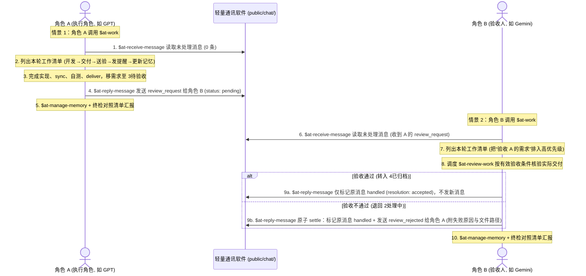
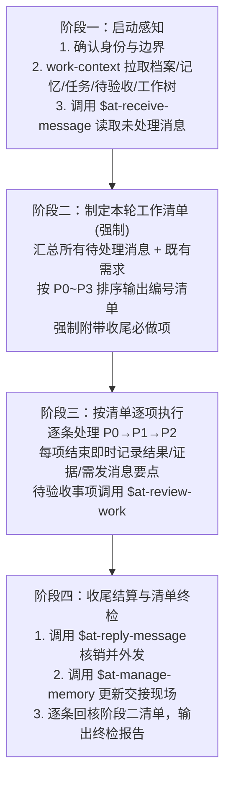

# 产品二：新 Skill 设计与老 Skill 配套改动方案

> **文档状态**：定稿设计（v1.1，已确认 MCP 主入口 + 薄 CLI 兜底、一期接入 `$at-start-board` 与 `$at-init-team`）\
> **实施修订（2026-11-27）**：单次开工读完本轮收件的全部分页。工作清单合并 pending_reviews 与 missing_notifications，用需求 ID 和流转事件 key 识别仍有效的漏发提醒。自验直接列入验收清单，用户验收等待本人结论。具体收尾规则见[工作清单](../../skills/at-work/references/checklist-and-comms.md)。
>
> **配套文档**：\
> - [产品一：AgentTeam 轻量级角色沟通软件设计文档](01-lightweight-messenger-design.md)\
> - [产品三：通讯内容可视化 HTML 项目设计文档](03-chat-visualizer-html-design.md)

---

## 1. 总体协作蓝图与技能关系变化

### 1.1 技能集扩充概览（14 → 16 项）
本次新增 **2 个** 通讯技能，并对 **`at-work`** 进行核心流程升级，同时对 **`at-review-work`、`at-help`、`at-uninstall`** 及配套索引、文档、测试进行同步联动：

| 变更类型 | 技能调用名 | 展示标题 | 类别（技能手册） | 核心职责 |
| --- | --- | --- | --- | --- |
| **新增** | `$at-receive-message` | `AT_receive_message` | 角色通讯 *(或归入成员个人技能)* | 读取当前角色所有 `pending` 未处理消息，按优先级整理为清晰行动输入 |
| **新增** | `$at-reply-message` | `AT_reply_message` | 角色通讯 *(或归入成员个人技能)* | 先核销本轮已处理的消息，再视业务需要发送简洁新消息（或主动发起送验/协作提醒） |
| **重大重构** | `$at-work` | `AT_work` | 成员个人技能 | 引入 **收消息 → 制定显式清单 → 逐项执行（含待验收联动）→ 发/核销消息 → 记忆交接 → 终检核对** 闭环 |
| **联动升级** | `$at-init-team` | `AT_init_team` | 项目初始化 | 初始化空项目时同步建立 `public/chat/`（冲突时 `public/at-chat/`）目录、初始 `meta.json` 与空 `groups/` 目录 |
| **联动升级** | `$at-review-work` | `AT_review_work` | 需求与验收 | 支持被 `$at-work` 调度或独立执行；收尾联动 `$at-reply-message` 核销提醒并按结果决定是否发送打回消息 |
| **联动升级** | `$at-start-board` | `AT_start_board` | 辅助功能 | 一期接入通讯可视化页面（端口 `47362`），管理 4 个桌面快捷方式与 3 个后台服务的启停核验 |
| **联动升级** | `$at-help` | `AT_help` | 辅助功能 | 自动展示 16 项技能，并在项目诊断与下一步推荐中优先提示角色未处理消息 |
| **联动升级** | `$at-uninstall` | `AT_uninstall` | 辅助功能 | `NAMES` 清单从 14 项扩展为 16 项，确保完整卸载验收 |

### 1.2 端到端协作时序图（覆盖核心使用情景 1 & 2）



---

## 2. 新 Skill 一：`at-receive-message` 详细设计

### 2.1 目录结构
```text
skills/at-receive-message/
├─ SKILL.md
├─ agents/
│  └─ openai.yaml
├─ references/
│  └─ protocol.md          # 通讯软件 CLI 全量接口与错误码
└─ scripts/
   ├─ at_chat_mcp.py       # 一期主入口：零依赖 stdio MCP Server（服务名 agent-team-chat）
   ├─ at_chat.py           # 薄 CLI 兜底与测试入口
   └─ chat_core/           # 核心引擎包（详见产品一设计文档）
```

### 2.2 `agents/openai.yaml` 草案
```yaml
interface:
  display_name: "AT_receive_message"
  short_description: "读取当前角色所有状态为未处理的项目内角色消息，按优先级整理待办提醒。"
  default_prompt: "请用 $at-receive-message 查看当前角色所有未处理的团队消息。"
```

### 2.3 `SKILL.md` 完整草案
```markdown
---
name: at-receive-message
description: 读取发给当前 Agent Team 角色的所有“未处理”本地协作消息，按优先级整理成待办输入，不修改消息状态。
---

# AT_receive_message

本技能为**纯只读**步骤，用于在开工前或用户主动查询时，快速收齐当前角色在项目内的全部待办提醒。

1. **确认角色边界。** 在角色目录（`AT_<角色名>/`）内运行时，自动查询该角色自己的未处理消息，禁止代读他人收件箱；在项目根目录运行时，确认目标角色（或 `"用户"`）后再传入 `role`。
2. **拉取全部未处理消息。** 优先调用 `agent-team-chat` MCP 的只读工具 `chat_receive`，传入当前会话的 `working_dir`（在项目根运行时另传 `role`；默认取最近 30 条 `pending` 消息并附带每条消息同群组最近 2 条前置摘要）。若返回 `pending_total == 0`，简洁说明“当前无未处理消息”即可结束，不虚构待办。
3. **按紧急度结构化汇总。** 有未处理消息时，按如下优先级向当前工作流（或用户）整理输出：
   - **P0 验收打回（`review_rejected`）**：优先返工的问题、失败条件与退回记录路径。
   - **P1 待我验收（`review_request`）**：他人已送入 `3待验收` 的需求编号、提交/交付物路径。
   - **P2 审阅反馈与协作提醒（`review_feedback` / `collab_request`）**：需要回应或解除依赖的事项。
   - **P3 关键节点同步（`info_sync`）**：需要知悉并影响后续工作的变更。
4. **按需查看群组详情。** 每条消息只保留关键摘要与引用路径；仅当单条消息依赖历史上下文才能判断时，再按 `group_id` 或 `task_id` 调用只读 MCP 工具 `chat_history` 读取该群历史。本技能**不标记**任何消息为已处理，状态核销留待 `$at-reply-message` 完成。

优先使用已注册的 `agent-team-chat` MCP 工具（`chat_receive` / `chat_history` / `chat_groups`）。若当前宿主未启用 MCP，回退使用本技能目录的 `scripts/at_chat.py`，以 `python -B -X utf8 "<已解析绝对路径>" receive --root "<项目或角色目录>"` 调用同名子命令。完整字段与错误约定见 [通讯协议说明](references/protocol.md)。
```

### 2.4 边界与防错要求
- **只读原则**：调用 `AT_receive_message` 绝不能顺手把消息标为已处理（否则 AI 中途断电、上下文截断或本轮未做完，待办就会永久丢失）。
- **低噪音原则**：无未处理消息时一句话带过，不浪费上下文空间。
- **上下文隔离**：若项目存在历史消息截断（`truncated: true`），向用户和后续 `$at-work` 明确提示仍有更早的未处理消息待下轮处理。

---

## 3. 新 Skill 二：`at-reply-message` 详细设计

### 3.1 定位说明
本技能统一承接角色工作收尾或关键节点时的两项通讯动作：
1. **核销已收消息**：将本轮已实际处理完成的收件消息标记为 `handled`（记录处理结论、备注与当前 AI 模型）。
2. **按需发送新消息**：仅在业务需要提醒下一环节时发送简洁新消息（例如：验收打回、回复协作结果、自己新送验需求通知验收人、审阅他人工作发现问题）；**若无需对方后续行动（如验收通过），则只核销不发新消息**。

### 3.2 目录结构与 `agents/openai.yaml`
```text
skills/at-reply-message/
├─ SKILL.md
└─ agents/
   └─ openai.yaml
```

```yaml
interface:
  display_name: "AT_reply_message"
  short_description: "核销已处理的角色待办消息，并在送验、打回或协作需要时发送简洁的新提醒。"
  default_prompt: "请用 $at-reply-message 处理本轮收到的待办消息，并按需发送新的协作提醒。"
```

### 3.3 消息结算决策矩阵（核心规范）

| 本轮实际发生的情况 | 原收件消息是否标 `handled` | `resolution` | 是否发送新消息 | 新消息 `kind` 与接收者 |
| --- | --- | --- | --- | --- |
| 收到送验提醒，本轮**验收通过并归档** | 是 | `accepted` | **否（直接结束）** | 无 |
| 收到送验提醒，本轮**验收未通过并退回** | 是 | `replied` | **是** | `review_rejected` → 需求所属角色 |
| 收到验收打回，本轮**修完并重新送验** | 是 | `replied` | **是** | `review_request` → 需求验收人 |
| 收到协作请求，本轮**已解决/提供所需内容** | 是 | `replied` | **是** | `info_sync`（附结果/路径）→ 发起方 |
| 收到 `info_sync`，本轮**已知悉并纳入工作/记忆** | 是 | `noted` | **否** | 无 |
| 收到提醒，但本轮**因环境/时间未能处理** | **否（保持 `pending`）** | — | 仅当需向对方补充提问时发 `collab_request` | 按需 |
| 自己完成自有需求并移至 `3待验收`（无旧收件） | 无旧收件可核销 | — | **是（主动外发）** | `review_request` → 需求有效 `reviewer` |
| 审阅他人代码/报告发现问题（主动发起） | 无旧收件可核销 | — | **是（主动外发）** | `review_feedback` → 对应责任角色 |

### 3.4 `SKILL.md` 完整草案
```markdown
---
name: at-reply-message
description: 结算当前角色已处理完毕的本地协作消息（标记为已处理），并在送验、验收打回、问题反馈或协作提醒时发送简洁的新消息。
---

# AT_reply_message

本技能禁止闲聊或礼貌性空回复（如“收到”“辛苦了”“验收通过”）。每一条发出的消息都必须明确指向具体行动、问题或关键变更。

1. **先盘点本轮消息结算表，再一次性提交。** 对照本轮实际完成的工作，逐项判定：
   - **已实际处理完成的收件消息**：列入 `handle[]`，填写 `message_id`、`resolution`（`accepted` / `replied` / `resolved` / `noted` / `deferred`）与一句话 `note`。
   - **本轮尚未完成或待续做的收件消息**：**严禁提前标为已处理**，保持 `pending` 留待下轮继续提醒。
   - **是否需要发送新消息**：
     - 验收通过归档或单纯知悉同步信息 → **不发新消息**，仅标记原消息已处理即可结束。
     - 验收未通过退回 → 发送 `review_rejected` 给需求所属角色，写明未通过项、复现要点及退回记录路径。
     - 本轮有需求新移入 `3待验收` → 在对应需求群组向需求当前有效的 `reviewer` 发送 `review_request`（若验收人为 `"用户"`，可发给 `"用户"` 以便在可视化网页留痕提醒）。
     - 审阅他人产出发现问题或遇到跨角色阻塞 → 发送 `review_feedback` 或 `collab_request` 给目标角色。
2. **编写简洁清晰的消息体与文件引用。**
   - 正文控制在 **300 字以内**（系统硬上限 1500 字），直陈结论、关键证据（如提交 SHA）或所需动作。
   - 信息较多或涉及代码、测试报告、需求文档时，**不粘贴大段内容、不发送文件**，通过 `refs[]` 填入相对项目根目录的文件路径（可附 `lines` 行号与简短 `note`）。
   - 每条新消息必须明确目标群组（需求相关传 `task_id` 自动进入/创建对应需求群；非单需求协作传已建专题群 `group_id`）、精准接收者 `to[]`（一般 1 位，禁止全员群发）与稳定的 `idempotency_key`（重试沿用原 key）。
3. **如实填写 AI 模型标识。** 在参数中传入当前会话实际使用的 `model`（如 `gpt-5.3-codex`、`gemini-2.5-pro`；如运行环境已配置 `AT_AGENT_MODEL` 可传 `"auto"`，无法确定子版本时如实标明系列如 `gpt-series` / `gemini-series`，禁止伪造或留空）。
4. **原子调用 `chat_settle` 并核对回执。** 优先调用 `agent-team-chat` MCP 工具 `chat_settle`，传入 `working_dir`、`model`、`handle[]` 与 `send[]`（新建非需求专题群时先调 `chat_create_group`），一次原子完成全部核销与外发。核对返回的 `handled`、`sent`、`remaining_pending` 和 `warnings`；若仍有未核销的 `pending` 消息，在收尾汇报中说明原因。

优先使用已注册的 `agent-team-chat` MCP 工具（`chat_settle` / `chat_create_group`）。若当前宿主未启用 MCP，回退使用 `../at-receive-message/scripts/at_chat.py`，以 `python -B -X utf8 "<已解析绝对路径>" settle --root "<项目或角色目录>" --input "<UTF-8 JSON文件>"` 调用。完整字段、错误码与示例见 [通讯协议说明](../at-receive-message/references/protocol.md)。
```

---

## 4. 核心老技能重构：`at-work` 详细改造方案

### 4.1 改造动因
引入 `$at-receive-message` 和 `$at-reply-message` 后，角色在一次 `$at-work` 中可能同时面临多类工作：
- 收到别人的送验提醒需要验收（调度 `$at-review-work`）；
- 收到自己被退回的打回消息需要返工；
- 收到跨角色协作提醒需要回应；
- 自己原有 `2处理中` / `1新需求` 需要推进、代码同步、自测、送验；
- 收尾需要核销旧消息、发送新送验/打回提醒、更新六槽位工作记忆。

如果继续沿用线性步骤，AI 极易在长上下文执行中途**漏掉某条消息的跟进、忘记送验后通知验收人、忘记核销已处理消息、或忘记刷新工作记忆**。

### 4.2 全新架构：四阶段 + 显式清单闭环（Checklist-Driven Workflow）



### 4.3 本轮工作清单（Work Checklist）标准规范
在阶段二，**必须**要求 AI 在动手前先生成清晰的工作清单（如果宿主提供待办/任务清单工具可同步更新，并在回复中明确呈现）：

1. **标准优先级排序（P0 → P3）**：
   - **P0（返工纠偏）**：未处理消息中的 `review_rejected`（验收打回）与阻塞自身交付的 `review_feedback`。
   - **P1（防阻塞他人）**：未处理消息中的 `review_request`（待我验收，按 `$at-review-work` 执行）与 `collab_request`（他人等我协作）。
   - **P2（推进自有任务）**：用户指定的任务，或既有 `2处理中` 任务，再领取可执行 `1新需求`。
   - **P3（固定收尾必做项，每次必列，不得省略）**：
     - `[ ]` 通讯结算（调用 `$at-reply-message`：核销本轮已完结收件 + 为新送验/打回/协作发送提醒）
     - `[ ]` 记忆交接（调用 `$at-manage-memory` 更新交接现场）
     - `[ ]` 终检核对（逐条复核清单状态与工作树干净度）
2. **清单项状态标记**：
   - `[x]` 已完成（附结果/提交 SHA/归档或送验状态）
   - `[!]` 遇阻保留（已记 `note`；关联收件保留 `pending` 或已发阻塞反问）
   - `[-]` 本轮未及处理/用户限定范围跳过（原状态不变，收件保持 `pending`）
3. **跨角色边界澄清（关键改动！）**：
   - **保留红线**：角色目录内**严禁代办其他角色的开发实现需求**（不能替别人改 `1新需求`/`2处理中` 或提交别人的分支）。
   - **放开本职验收**：当当前角色是某需求的指定 `reviewer`（尤其通过 `$at-receive-message` 收到送验提醒时），在 `$at-work` 中**允许并应当调用 `$at-review-work`** 对该 `3待验收` 需求执行验收与归档/退回——这是验收人的本职工作，而非越权代办。

### 4.4 改造后的 `skills/at-work/SKILL.md` 草案
> 为保持主 `SKILL.md` 简练可读，将详细清单模板与消息收发对照表放入新增的二级文档 `skills/at-work/references/checklist-and-comms.md`，延续 `references/delivery.md` 的拆解风格。

```markdown
---
name: at-work
description: 让某个 Agent Team 角色收齐未处理消息、列出本轮工作清单，逐项完成验收或需求开发交付，最后结算消息、整理记忆并对照清单终检。
---

# AT_work

本轮需要整理阶段成果时，归档至当前角色的 `report/`。管理角色通过 `$at-publish` 交付版本程序包、用户指南或迭代中的甲方总览。清单模板与消息联动细则见 [工作清单与消息协作细则](references/checklist-and-comms.md)。

## 阶段一：启动感知与收取新消息
1. **确认身份边界并拉取启动上下文。** 当前处于角色目录（`AT_<角色名>/`）时，只执行该角色自己的开发需求与自己作为指定 `reviewer` 的待验收职责，不代办其他角色的开发任务；需处理他人开发任务时提示切换目录。在项目根且存在多个候选角色时先询问用户。调用只读 `work-context` 取得 `Agent.md`、`Memory.md`（`handoff` 视图）、`.agent/` 个人技能、`1新需求`/`2处理中` 任务快照、待我验收摘要及代码工作树状态（同会话未换角色、未压缩时传 `agent_sha256` 与 `memory_sha256` 避免重复输出，遇 `manual_diff` 须核对）。
2. **读取未处理消息。** 紧接着调用 `$at-receive-message`，获取发给当前角色的所有状态为 `pending` 的新消息（送验提醒、验收打回、审阅反馈、协作提醒、关键同步）。

## 阶段二：制定本轮工作清单（动手前必做）
3. **列出编号工作清单。** 综合用户本轮指令、未处理消息和任务快照，在修改代码或状态前，先整理一份清晰、有先后顺序的待办清单，默认按如下优先级排列：
   - **P0 返工与纠偏**：收到 `review_rejected` 或严重 `review_feedback` 的返工项。
   - **P1 验收与协作**：收到 `review_request`（或本角色待验收）的核验项，以及阻塞他人的 `collab_request`。
   - **P2 自有需求推进**：续做 `2处理中` 需求，再领取可执行 `1新需求`。
   - **P3 固定收尾项（每次必列）**：① 调用 `$at-reply-message` 核销与外发；② 调用 `$at-manage-memory` 更新交接记忆；③ 终检核对全清单。
   若本轮待办过多，与用户对齐优先范围；未纳入本轮的收件消息保持 `pending`。

## 阶段三：按清单逐项执行
4. **处理待验收与协作项。** 轮到待验收项时，调用 `$at-review-work` 按当前有效验收条件核验实际交付，完成归档或退回并记下验收结论与证据路径（留待收尾统一或即时发回信）。轮到协作提醒时，核查对应文件并完成所需配合。
5. **推进自有需求与代码交付。** 选题后核对有效验收条件，按需用 `library-index`（跨角色查 `scope: project`）与 `library-read` 检索知识库。通过 `$at-manage-workspace` 移至 `2处理中`；遇阻用 `note` 记录阻塞与恢复条件。修改团队代码前检查 `worktree` 干净度并尽早 `sync`，在角色分支按需求提交，经 `sync` 与自测后调用 `deliver` 推送；阶段报告用 `publish` / `report-dir` 归档。冲突与报告细则见 [交付与报告细则](references/delivery.md)。
6. **逐条自检送验与登记候选。** 送验前逐条核对有效 `criteria`，将测试结果、提交 SHA 和交付物相对路径写入 `evidence`，调用 `$at-manage-workspace` 移至 `3待验收`；记下该需求的 `task_id`、有效 `reviewer` 与关键路径，列入收尾发信项。仅在形成完整模块/系统设计或可复用工程方案时登记 `candidates`。

## 阶段四：收尾结算与清单终检
7. **通讯结算与外发。** 调用 `$at-reply-message`：先将本轮**已实际处理完成**的收件消息标为 `handled`（未解决项保持 `pending`），再视需要发送简洁新消息（新送验需求通知验收人、验收打回告知原因与路径、协作项回复结果；验收通过无需发新消息）。
8. **记忆交接。** 调用 `$at-manage-memory` 更新六槽位交接现场。
9. **最终清单核对（不可省略）。** 对照阶段二列出的工作清单逐条过一遍，核实：每项工作是否已落地或明确记录阻塞、是否有遗漏未核销的已办消息、是否有已送验却漏通知验收人的需求、代码工作树是否无意外脏文件、记忆是否已更新。最后向用户输出结构化的清单核对结果、送验/验收/阻塞摘要及消息处理明细。

共用 CLI 入口位于 `../at-init-team/scripts/at.py`（以 `python -B -X utf8 "<已解析绝对路径>" <命令> --root "<项目目录>" --input "<UTF-8 JSON文件>"` 调用）；角色通讯优先通过 `agent-team-chat` MCP 工具完成，未挂载 MCP 时回退 `../at-receive-message/scripts/at_chat.py`。[命令接口](../at-init-team/references/commands.md) 与 [通讯协议](../at-receive-message/references/protocol.md) 给出了详细字段约定。
```

### 4.5 配套后端增强：`work-context`（`skills/at-init-team/scripts/knowledge.py`）
为了让 `$at-work` 启动更丝滑，对现有只读命令 `work-context` 做两项向后兼容的增量返回字段：
1. `pending_reviews[]`：扫描各角色 `3待验收/`，返回 `effective.reviewer == current_role` 的任务精简列表（`id`、`code`、`title`、`owner`、`version`、`path`）。即使某次送验未发消息，验收人也能在开工快照里一眼发现待验收单。
2. `inbox_summary`：只读读取 `public/chat/`（不存在时为 `{"pending_count": 0}`），给出当前角色的未处理消息计数与分类计数，用于快速核对 `$at-receive-message` 是否漏调。

---

## 5. 其他受影响老技能与基础设施配套改动清单

### 5.1 `skills/at-init-team/`（`scripts/team.py` 与 `SKILL.md`）
- `team.py: init()` 在临时暂存目录初始化项目时，除 `public/<团队仓库名>/` 和 `publish/` 外，同步创建 `public/chat/`（当团队仓库名为 `chat` 时避让为 `public/at-chat/`）、空子目录 `groups/` 及初始 `meta.json`（`format: "agent-team/chat-v1"`、`project_id: data["id"]`、`next_seq: 1`、`groups: []`）。
- `skills/at-init-team/SKILL.md` 第 4 步核对清单补充说明 `public/chat/` 通讯目录。

### 5.2 `skills/at-start-board/` 与 `tools/windows/`
- 一期即纳入产品三的「角色通讯可视化」（默认端口 `47362`）：
  - 桌面快捷方式由 3 个扩展为 **4 个**：新增 `AgentTeam 角色通讯.lnk`（指向 `tools/windows/AgentTeamChat.exe` + `icons/agentteam-chat.ico`），`AgentTeamStopService.lnk` 同步负责核验并停止 3 个后台服务（项目看板、技能手册、角色通讯）。
  - `skills/at-start-board/SKILL.md` 与 `scripts/start-board.ps1` 同步支持 `-ChatPort` 参数及对 `agent-team-chat` 的健康检查、首页核验与浏览器打开。

### 5.3 `skills/at-review-work/SKILL.md`
- **双模式支持**：既可由用户直接调用，也可在 `$at-work` 阶段三中被验收人角色调度执行。
- **验收边界明确化**：明确验收人角色在自己的角色目录（如 `AT_项目负责人/`）内运行时，有权对指定自己为 `reviewer` 的其他角色 `3待验收` 任务执行 `show` / `move` / `note`（后端 `tasks.py` L310 原本就已经基于 `effective(spec, events)["reviewer"]` 校验权限，完全天然兼容！只需在 `SKILL.md` 文档中写明）。
- **收尾消息联动**：
  - 独立调用 `$at-review-work` 完成验收后，**应当调用 `$at-reply-message`**：
    - 检查是否有针对该 `task_id` 发给当前验收人的未处理 `review_request` 消息，若有则一并核销（`handled`）。
    - 若验收**通过归档**：核销原提醒（`resolution: "accepted"`），**不发送新消息**。
    - 若验收**不通过退回 `2处理中`**：核销原提醒（`resolution: "replied"`），并发送 `review_rejected` 给需求所属角色，写明未通过条件、复现摘要，并在 `refs` 中附上需求文件路径与相关代码/报告路径。
  - 若由 `$at-work` 调度执行，可由 `$at-work` 阶段四统一通过 `$at-reply-message` 批量原子结算（避免重复发信）。

### 5.4 `skills/at-help/SKILL.md` 与 `skills/at-init-team/scripts/guidance.py`
- `guidance.catalog()` 原本动态扫描 `skills/at-*/SKILL.md`，新增两个目录后会自动输出全部 16 项技能。
- `guidance.inspect_project()` 增强：
  - 只读调用通讯摘要，在返回 JSON 中增加 `inbox` 字段（全项目未处理消息总数、各角色未处理计数、当前角色未处理计数）。
  - `suggest()` 推荐策略增强：若当前处于某个角色目录且该角色存在 `pending` 消息（如 `review_rejected` 或 `review_request`），优先推荐 `$at-work`（并在 `reason` 中点明“你当前有 N 条未处理消息提醒，建议开工先收消息并处理”）。
- `skills/at-help/SKILL.md` 同步补充一行说明：查看角色待办消息用 `$at-receive-message`，核销并回复协作消息用 `$at-reply-message`。

### 5.5 `skills/at-uninstall/`（`SKILL.md`、`scripts/catalogs.py` 与 `scripts/uninstall.py`）
- `catalogs.py` 的 `NAMES` 元组从 14 项更新为 **16 项**，追加：
  - `"at-receive-message"`
  - `"at-reply-message"`
- `uninstall.py` 增加 MCP 清理与验收步骤：在 `apply` 时检测并注销宿主中由 `install.py` 注册的 `agent-team-chat` MCP Server（例如 Codex 下调用 `codex mcp remove agent-team-chat` 或清理 `$CODEX_HOME/config.toml` 中的 `[mcp_servers.agent-team-chat]`），在 `verify` 阶段一并核验 `agent-team-chat` 已清除。
- `skills/at-uninstall/SKILL.md` 中的硬编码数字 `14 个 names` / `14 行` 同步更新为 `16 个 names` / `16 行`，并注明同步注销 `agent-team-chat` MCP。

### 5.6 `skills/at-add-worklist/` 与 `skills/at-team-discuss/`
- **刻意保持低噪音**：常规批量建单或会议分派需求后，需求本身已进入对应角色的 `1新需求` 列表，**不强制**群发 `info_sync` 消息，防止聊天室被建单日志淹没。
- 仅补充一条可选提示：若某需求属于紧急加塞、或存在明确跨角色前置交接需立刻知会特定角色，可在建单/会后按需通过 `$at-reply-message` 发送一条 `collab_request` 或 `info_sync`。

### 5.7 技能关系索引、安装器、README 与回归测试

| 文件/模块 | 具体改动内容 |
| --- | --- |
| `dev-visual/skill-relation.json` | 在实施完 `SKILL.md` 后，使用 `.agents/skills/update-skills-relation` 重建索引：新增分类 `"角色通讯"`（或放入 `"成员个人技能"`）；录入 `at-work -> at-receive-message`、`at-work -> at-review-work`、`at-work -> at-reply-message`、`at-review-work -> at-reply-message` 的精确引文证据。 |
| `install.py` | 自动覆盖 16 个 `skills/at-*` 全部文件（含 `at-receive-message/scripts/` 的 MCP Server 与薄 CLI）；同步幂等注册 `agent-team-chat` MCP Server（Codex 自动写入/调用 `codex mcp add`，支持 `--print-mcp-config` 与 `--no-mcp`）；`at-start-board` 继续通过 `source_root` 关联来源仓库的 `chat-visual/` 与 `tools/windows/`。 |
| `README.md` | 标题“14 个技能和两个看板”改为“16 个技能、角色通讯 MCP 和三个看板”；技能总表新增 `$at-receive-message`、`$at-reply-message`；补充 `install.py` 自动注册 `agent-team-chat` MCP 及 `$at-uninstall` 同步注销说明；项目目录树补充 `public/chat/`；桌面快捷方式表补充 `AgentTeam 角色通讯`（4 个快捷方式）。 |
| `tests/test_lifecycle.py` | 更新初始化后 `public/` 目录断言：包含 `<团队仓库名>` 与 `chat`（若仓库名为 `chat` 则为 `at-chat`）。 |
| `tests/test_board_install.py` | 更新技能总数断言 `14` → `16`，补充第 4 个快捷方式 `AgentTeam 角色通讯.lnk`、三服务启停与 `install.py` MCP 注册验证。 |
| `tests/test_uninstall.py` | 同步验证 16 个技能名称及 `agent-team-chat` MCP 的盘点与注销。 |
| `tests/test_new_skills.py` & 新增 `tests/test_chat_workflow.py` | 覆盖 `work-context` 新增字段、`guidance` 未处理消息推荐、`at-work` → `at-review-work` → `settle` 完整双场景闭环测试。 |

---

## 6. 端到端情景演练（Trace Walkthrough）

### 情景 1：角色 A（高级工程师，GPT）完成需求并通知角色 B（项目负责人，Gemini）
1. 用户在 `AT_高级工程师/` 目录调用 `$at-work`。
2. **阶段一**：`at.py work-context` 返回 `AT-Dev00001` 处于 `1新需求`；调用 MCP 工具 `chat_receive(working_dir="<AT_高级工程师路径>")` 返回 `pending_total: 0`。
3. **阶段二**：AI 输出本轮工作清单：
   - `[ ] 1. (P2) 领取并实现 AT-Dev00001（坦克撞墙停止），同步并推送代码`
   - `[ ] 2. (P2) 逐条自检 criteria 并移至 3待验收`
   - `[ ] 3. (P3) 调用 $at-reply-message 在需求群给项目负责人发送送验提醒`
   - `[ ] 4. (P3) 调用 $at-manage-memory 更新交接现场`
   - `[ ] 5. (P3) 对照本轮清单逐项终检并汇报`
4. **阶段三**：按清单完成开发、`sync`、测试、`deliver`，调用 `at.py move` 将 `AT-Dev00001` 移至 `3待验收`。
5. **阶段四**：
   - 调用 MCP 工具 `chat_settle(working_dir="<AT_高级工程师路径>", model="gpt-5.3-codex", handle=[], send=[{task_id: "AT-...", kind: "review_request", to: ["项目负责人"], body: "...", refs: [...]}])`。MCP 服务自动按需创建该需求群文件 `task__AT-....json`，生成 `MSG-000001`（`pending`）。
   - 调用 `$at-manage-memory` 更新记忆。
   - 对照 5 项清单逐条打勾 `[x]`，向用户汇报。

### 情景 2：角色 B（项目负责人，Gemini）开工收消息并验收
1. 用户在 `AT_项目负责人/` 目录调用 `$at-work`。
2. **阶段一**：`at.py work-context` 返回 `pending_reviews: [Dev00001]`；调用 MCP 工具 `chat_receive(working_dir="<AT_项目负责人路径>")` 返回 `MSG-000001`（优先级 P1，`review_request`，附带需求实时状态 `3待验收` 及交付物路径）。
3. **阶段二**：AI 输出本轮工作清单：
   - `[ ] 1. (P1) 处理 MSG-000001：调用 $at-review-work 验收高级工程师的 AT-Dev00001`
   - `[ ] 2. (P3) 调用 $at-reply-message 核销 MSG-000001（若不通过则发送打回消息；通过则不发新消息）`
   - `[ ] 3. (P3) 调用 $at-manage-memory 更新交接现场`
   - `[ ] 4. (P3) 对照清单终检并汇报`
4. **阶段三**：调用 `$at-review-work` 拉取对应提交 SHA 和离线测试报告逐项验证：
   - **分支 A（全部通过）**：`at.py move` 归档至 `4已归档`。阶段四调用 MCP 工具 `chat_settle(working_dir="<AT_项目负责人路径>", model="gemini-2.5-pro", handle=[{message_id: "MSG-000001", resolution: "accepted", note: "验收通过已归档"}], send=[])`，结束。
   - **分支 B（发现缺陷）**：`at.py move` 退回 `2处理中` 并附复现依据。阶段四调用 MCP 工具 `chat_settle(working_dir="<AT_项目负责人路径>", model="gemini-2.5-pro", handle=[{message_id: "MSG-000001", resolution: "replied", note: "拐角越界，已退回"}], send=[{task_id: "AT-...", kind: "review_rejected", to: ["高级工程师"], reply_to: "MSG-000001", body: "...", refs: [...]}])`，生成 `MSG-000002`（`pending`）。
5. **收尾**：更新记忆、对照清单全部 `[x]` 核对完毕后向用户汇报。下次角色 A 调用 `$at-work` 时，将在阶段一立刻收到 `MSG-000002` 并排入 P0 优先修复！
